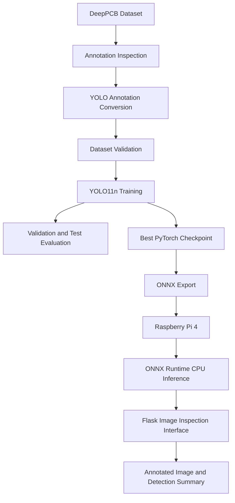

# System Architecture

## 1. Overview

The system follows an offline training and edge-inference workflow. Model development is performed on a MacBook, while the exported ONNX model is intended for CPU inference on a Raspberry Pi.

## 2. End-to-End Workflow

## 3. Model Development

The dataset preparation and training workflow is implemented under `ai-model/`.

The selected YOLO11n model is trained using 640 × 640 input images. Training and test evaluation records are maintained under `results/model/train-2/`.

## 4. Edge Inference

The Raspberry Pi application is implemented in `raspberry-pi/app/image_demo.py`.

Its processing stages are:

1. Receive a PCB image through the Flask interface.
2. Decode the uploaded image using OpenCV.
3. Resize and pad the image using letterbox preprocessing.
4. Convert BGR to RGB.
5. Normalize pixel values to the range [0, 1].
6. Convert the image into NCHW tensor format.
7. Run ONNX inference using CPUExecutionProvider.
8. Decode predictions and apply class-aware non-maximum suppression.
9. Map detections back to the original image.
10. Display annotated results and detection summaries.

## 5. Application Interface

The Flask application provides browser-based image inspection. The current implementation supports image uploads; an integrated live-camera pipeline is not part of the current application.

## 6. Deployment Boundary

The ONNX model is loaded locally by the Raspberry Pi application. Inference does not require a cloud inference service.

The current implementation uses CPU execution. FPGA acceleration and live-camera integration are outside the implemented scope.
